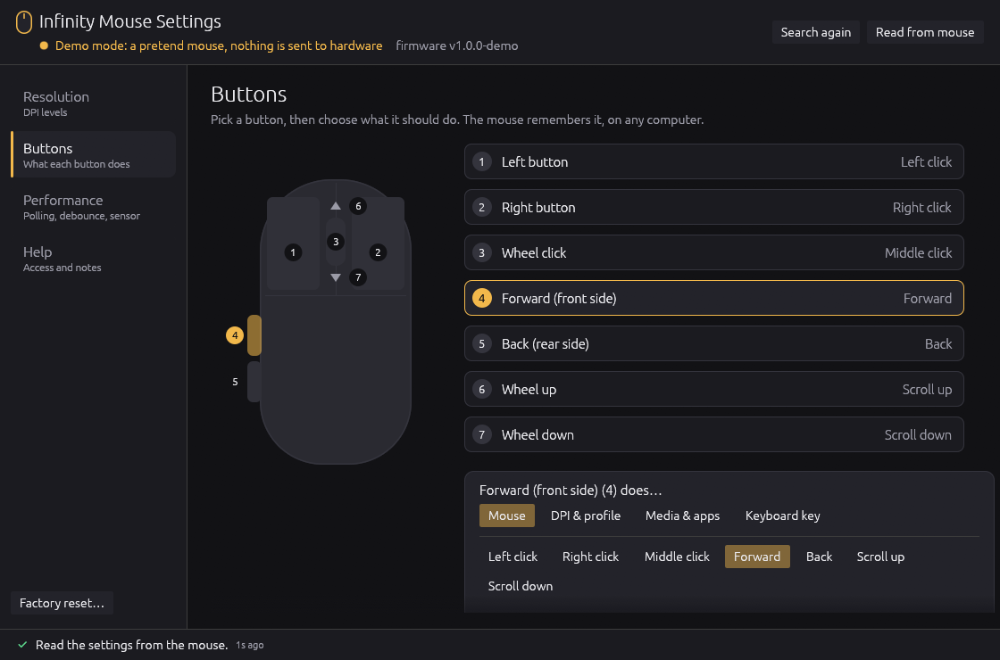

# Infinity Mouse Settings

An **unofficial** Linux settings app for the AngryMiao **AM Infinity** mouse.

AngryMiao's own app, AM Master, only runs on Windows. This app changes the same settings
from Linux. Settings are stored on the mouse itself, so they stay the same on every computer.

> This is an independent community project. It is not made, endorsed or supported by
> AngryMiao. AngryMiao and AM Infinity are trademarks of their owner. See [NOTICE.md](NOTICE.md).



## What it can change

- **Resolution:** 1 to 8 DPI levels, each from 50 to 30000 DPI in steps of 50, with separate
  X and Y values if you want them. You can also choose the active level and turn the quick
  DPI switch (side buttons + wheel) on or off.
- **Buttons:** what each of the 7 buttons does. Options are mouse clicks, scrolling,
  DPI up/down/cycle, profile switch, media and app keys, or any keyboard key with
  Ctrl/Shift/Alt/Super.
- **Performance:** polling rate (125 to 8000 Hz), click debounce (7 steps), lift-off distance,
  motion sync, angle snapping, ripple control, game (FPS) mode and factory reset.

Each change is sent to the mouse as soon as you make it.

## Not supported yet

Lighting colours, macro editing, wireless sleep timers and firmware updates.

Only the wired (USB cable) connection has been tested. The 2.4 GHz receiver and Bluetooth have not.

## Build

You need Rust: install it from <https://rustup.rs>.

```sh
cargo build --release
./target/release/infinity-mouse-settings
```

Tested on Ubuntu. It should work on other Linux distributions that use udev.

## First run: allow access to the mouse

By default, Linux only lets the administrator (root) send settings to the mouse.
On first run the app shows an **Allow access** button. It installs this rule file
(you are asked for your password once):

```
/etc/udev/rules.d/70-am-infinity-mouse.rules
```

To install the rule yourself instead:

```sh
sudo cp packaging/70-am-infinity-mouse.rules /etc/udev/rules.d/
sudo udevadm control --reload-rules && sudo udevadm trigger
```

To undo it, delete that file.

## Command-line options

| Option | What it does |
|---|---|
| `--demo` | Use a pretend mouse. Nothing is sent to real hardware. |
| `--page resolution\|buttons\|performance\|help` | Open on a given page. |
| `--read` | Print every setting stored on the mouse, change nothing. |
| `--screenshot file.png` | Save a picture of the window and exit. |

## How it works

The app talks to the mouse over its USB HID settings interface (`/dev/hidraw*`). It uses
the same commands as AM Master. [docs/PROTOCOL.md](docs/PROTOCOL.md) lists every command
and value, and where each one was learned.

## Libraries

[egui / eframe](https://github.com/emilk/egui), [libc](https://github.com/rust-lang/libc) and
[png](https://github.com/image-rs/image-png). Each is licensed under MIT or Apache-2.0.

## License

MIT. See [LICENSE](LICENSE).
